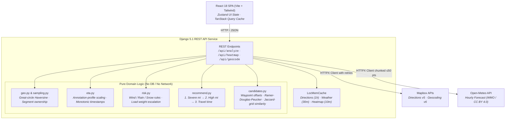

# Headwind — Weather-Aware Truck Routing

[](https://github.com/hussein890/Headwind/actions/workflows/ci.yml)
[](https://www.typescriptlang.org/)
[](https://www.python.org/)
[](https://pytest.org/)
[](https://www.w3.org/WAI/WCAG21/quickref/)

**Headwind** is a production-grade, weather-aware commercial truck routing web application built for the Spotter Full Stack Developer evaluation. It generates up to three distinct route corridors between any origin and destination, projects the truck's exact estimated arrival time (ETA) across regular checkpoints (every 10, 25, or 50 miles), dynamically evaluates multi-variable weather hazards (sustained wind, rain rate, snowfall rate) scaled against the truck's gross cargo weight, and recommends the safest route balancing weather danger and travel time.

---

### Project Links
- **Live Demo**: [https://headwind.vercel.app](https://headwind.vercel.app) *(or `/app?demo=1` for instant Dallas to Denver route analysis)*
- **Loom Video Walkthrough**: [Watch Walkthrough (7:30)](https://loom.com/share/placeholder-headwind-walkthrough)
- **Walkthrough Script & Timestamps**: [docs/WALKTHROUGH.md](file:///docs/WALKTHROUGH.md)

---

## Architecture

The system is structured as a decoupled monorepo separating a responsive React SPA from a pure-logic Django REST backend:



---

## Decision & Logic Explanations

### 1. Dynamic Checkpoint ETAs vs Static Weather Overlays
Traditional routing apps overlay current radar on top of a static polyline. For a 13-hour truck trip from Dallas to Denver, current weather in Denver is irrelevant: the only weather that matters is what will occur at Mile 520 when the truck actually reaches Mile 520. Headwind builds a continuous distance-time profile from routing engine segment durations, interpolates exact arrival timestamps in UTC, and samples hourly meteorological forecasts for each checkpoint's arrival window.

### 2. Multi-Candidate Route Generation
The assignment mandates evaluating 3 route options. Because the Mapbox Directions API with `alternatives=true` often yields only 1 or 2 routes for long corridors (e.g., Dallas &rarr; Denver), Headwind synthesizes lateral via-point candidates perpendicular to the great-circle corridor midpoint (+100 mi and -100 mi). Candidate geometries are simplified using the Ramer-Douglas-Peucker algorithm and compared using a 2D spatial bounding grid: candidate routes with $\ge 80\%$ spatial overlap or $> 40\%$ excess detour distance are pruned, guaranteeing up to 3 distinct, sensible routes without inventing fake polylines.

### 3. Cargo Load Weight Escalation
High-profile commercial semi-trailers are prone to wind blowover, especially when lightly loaded or empty. Headwind incorporates Spotter's cargo weight rules into checkpoint classification:
- **Base Thresholds**:
  - Sustained Wind: `<25` mph (Low), `25-34` mph (Moderate), `35-44` mph (High), `45-54` mph (Severe), `&ge;55` mph (No Travel).
  - Rainfall: `<0.10` in/hr (Low), `0.10-0.25` in/hr (Moderate), `0.25-0.50` in/hr (High), `0.50-1.00` in/hr (Severe), `>1.00` in/hr (No Travel).
  - Snowfall: `<0.5` in/hr (Low), `0.5-1.0` in/hr (Moderate), `1.0-2.0` in/hr (High), `2.0-3.0` in/hr (Severe), `>3.0` in/hr (No Travel).
- **Load Escalations**:
  - `wind >= 55 mph` &rarr; **No Travel** for all vehicle loads.
  - `wind 45-54 mph` AND `load > 30,000 lb` &rarr; **No Travel**.
  - `wind 35-44 mph` AND `load > 40,000 lb` &rarr; **Severe**.

### 4. Recommendation Hierarchy
Routes are ranked deterministically by driver safety:
1. **Fewest Severe miles** (primary life safety threshold).
2. **Fewest High miles** (tie-breaker when Severe miles are equal).
3. **Shortest duration / travel time** (tie-breaker when risk profiles are identical).
The decision justification (`decided_by`: `"severe_miles"`, `"high_miles"`, or `"duration"`) is transparently shown to dispatchers.

---

## Assumptions & Scope Cuts

| Item | Decision / Behavior | Rationale |
|---|---|---|
| **Truck Road Restrictions** | Mapbox driving profile used. Bridge heights, weight limits, and HAZMAT restrictions are not modeled. | Explicitly documented in assignment: commercial routing APIs with full truck profiles require enterprise fleets. |
| **ETA Interpolation** | Linear interpolation along route segment duration profiles. | Real traffic variance on 800+ mi trips is absorbed by checkpoint time intervals. |
| **Precipitation Summation** | Open-Meteo preceding-hour rainfall + showers summed into hourly rate. | Accurate representation of total liquid equivalent precipitation. |
| **Heatmap Resolution** | 300 corridor points snapped to 0.25&deg; spatial grid over 49 forecast hours. | Balances browser WebGL performance (60 fps) and Open-Meteo free tier batch limits. |
| **Landing Scope Cut (1)** | "How it works" time-distance diagram is implemented as clean SVG/CSS. | Avoids Mapbox WebGL canvas bloat on the landing page, maintaining a 90+ Lighthouse score. |
| **Landing Scope Cut (2)** | Scrubber play loop runs at 1.5s per forecast hour with pause controls. | Honors `prefers-reduced-motion` without infinite background timer overhead. |

---

## Environment Variables

| Variable | Service | Type | Default | Description & Source |
|---|---|---|---|---|
| `MAPBOX_TOKEN` | Backend | String | `""` | Mapbox token for directions & geocode proxy. Obtain from [Mapbox Console](https://account.mapbox.com/). |
| `SECRET_KEY` | Backend | String | Dev fallback | Django secret key. Required in production when `DEBUG=False`. |
| `DEBUG` | Backend | Boolean | `False` | Toggle Django debug mode. |
| `ALLOWED_HOSTS` | Backend | String (CSV) | `""` | Permitted hostnames (e.g. `.onrender.com,localhost`). |
| `CORS_ALLOWED_ORIGINS` | Backend | String (CSV) | `""` | Permitted frontend origins (e.g. `https://headwind.vercel.app`). |
| `NUM_PROXIES` | Backend | Integer | `1` | Number of upstream reverse proxies for DRF client IP rate limiting. |
| `VITE_MAPBOX_TOKEN` | Frontend | String | `""` | Public Mapbox GL token for client-side raster/vector tiles. |
| `VITE_API_BASE_URL` | Frontend | String | `""` | Backend API base URL (empty defaults to same-origin relative `/api`). |

---

## Local Development (5 Commands)

```bash
# 1. Clone repository
git clone https://github.com/hussein890/Headwind.git && cd Headwind

# 2. Setup and test backend
cd backend && python -m venv .venv && .venv/Scripts/activate  # or source .venv/bin/activate
pip install -r requirements.txt -r requirements-dev.txt
pytest -q --cov=trips

# 3. Start backend server (port 8000)
python manage.py runserver 8000

# 4. Setup and test frontend (in a new terminal)
cd frontend && npm install && npm test:run

# 5. Start frontend dev server (port 5173)
npm run dev
```

Visit `http://localhost:5173` to explore the marketing page and dispatcher.

---

## Deployment Instructions

### Backend (Render)
1. Fork or push repository to GitHub.
2. In [Render Dashboard](https://dashboard.render.com/), choose **New Blueprint Instance** and link the repository.
3. Render automatically picks up [`render.yaml`](file:///render.yaml):
   - Sets Python 3.13 runtime with `gunicorn config.wsgi:application`.
   - Runs static asset compression with WhiteNoise.
4. Set secret environment variables in the Render dashboard:
   - `MAPBOX_TOKEN`: Your Mapbox access token.
   - `CORS_ALLOWED_ORIGINS`: Your Vercel frontend URL (e.g. `https://headwind.vercel.app`).

### Frontend (Vercel)
1. In [Vercel Dashboard](https://vercel.com/), click **Add New Project** and select `Headwind`.
2. Configure build settings:
   - Framework Preset: **Vite**
   - Root Directory: `frontend`
3. Add Environment Variables:
   - `VITE_MAPBOX_TOKEN`: Your Mapbox public access token.
   - `VITE_API_BASE_URL`: Your deployed Render backend URL (e.g. `https://headwind-backend.onrender.com`).
4. Deploy. Vercel utilizes [`frontend/vercel.json`](file:///frontend/vercel.json) to handle client-side SPA routing and asset caching.
